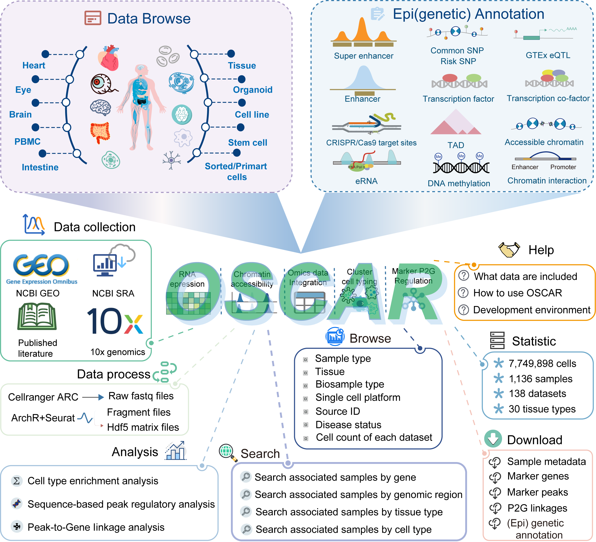

# Welcome to OSCAR!

> **OSCAR:** [https://bio.liclab.net/OSCAR/](https://bio.liclab.net/OSCAR/)
>
> OSCAR is a human single-cell multi-omics platform for paired RNA-seq and ATAC-seq data.

cite: Chao Song, Yao Zhou, Chenchen Feng, Xintong Dai, Jiaxin Xiao, Xuan Fan, Kewei Wang, Pengxiang Xiao, Yixin Zheng, Wenxi Luo, Chunquan Li, Qiuyu Wang, OSCAR: an omics atlas of paired single-cell ATAC-seq and RNA-seq for decoding cell-specific gene regulation, Nucleic Acids Research, 2026;, gkag1033, https://doi.org/10.1093/nar/gkag1033

---

## Contact us

**Principal Investigator:** Chunquan Li, Ph.D.

The First Affiliated Hospital, University of South China, Hengyang 421001, China

**Email:** [lcqbio@163.com](mailto:lcqbio@163.com)
